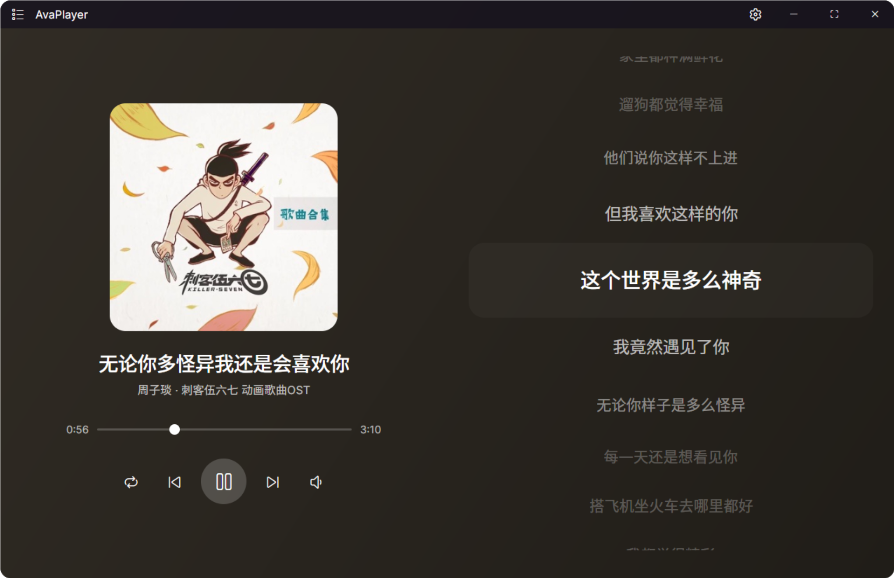
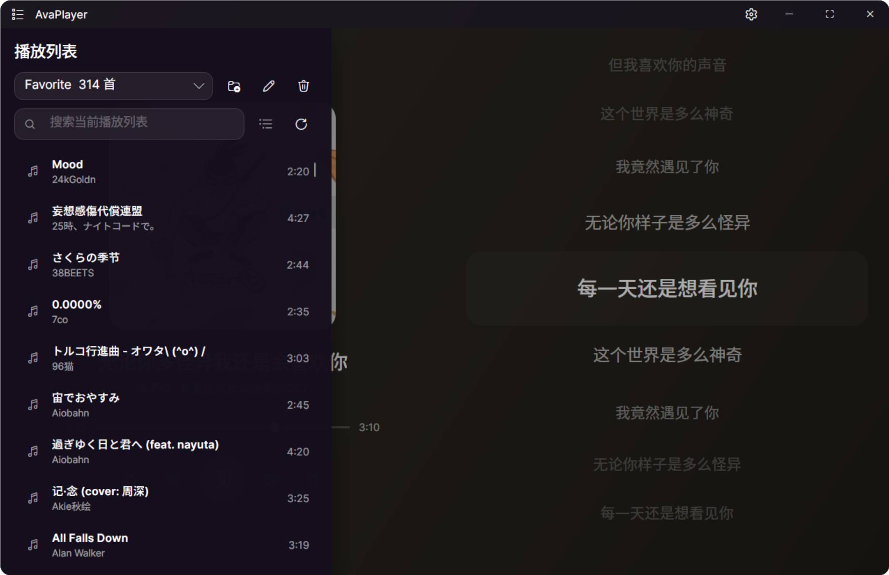
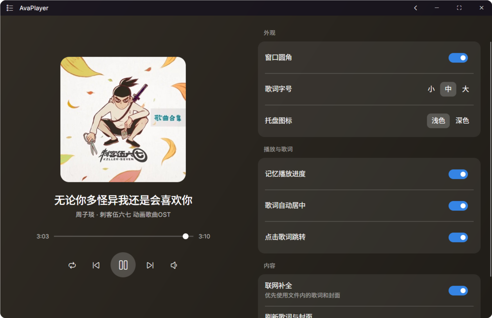

# AvaPlayer

一个基于 **.NET 11 + Avalonia 12** 的本地桌面音乐播放器：

- 本地优先、尽量少联网的音乐播放体验
- `MiniAudioExNET` 驱动的本地音频播放
- SQLite 本地数据存储
- 歌词、封面、播放列表、系统托盘、会话恢复
- Linux MPRIS / Windows 系统媒体控制联动

## 界面预览

| 主播放界面 | 播放列表抽屉 | 设置界面 |
| --- | --- | --- |
|  |  |  |

## 技术栈

| 类别 | 技术 |
| --- | --- |
| UI | Avalonia 12、FluentIcons.Avalonia |
| 音频后端 | JAJ.Packages.MiniAudioEx |
| 本地数据库 | Microsoft.Data.Sqlite |
| 元数据读取 | TagLibSharp |
| 网络能力 | HttpClientFactory |
| Linux 媒体控制 | Tmds.DBus.Protocol |

## 开发与验证

需要 **.NET 11 SDK**。在仓库根目录运行：

```bash
dotnet restore AvaPlayer.slnx
dotnet build AvaPlayer.slnx -c Debug --no-restore
dotnet test AvaPlayer.Tests/AvaPlayer.Tests.csproj -c Debug --no-build
dotnet format AvaPlayer.slnx whitespace --verify-no-changes --no-restore
dotnet format AvaPlayer.slnx analyzers --verify-no-changes --no-restore
```

模块职责、依赖方向与服务生命周期见 [架构说明](docs/architecture.md)。

## 网络与隐私

音乐文件与播放列表保留在本地。启用联网歌词/封面查询时，应用会把曲名、艺人等检索元数据发送给对应服务；不会上传音频文件。
当前使用的查询源包括 `lrclib.net`、`api.lrc.cx`、`music.163.com`、`api.lyrics.ovh`
和 Apple iTunes Search API。可在设置中关闭网络访问。

## 许可证

本项目使用 MIT 许可证，详见 [LICENSE](LICENSE)。
